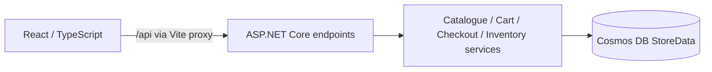

# IPL Franchise Merchandise Store

An assessment application for browsing IPL merchandise, maintaining customer carts and purchasing stock without overselling. ASP.NET Core/.NET 10 and the Cosmos DB SDK provide atomic multi-product checkout, optimistic inventory concurrency, durable cart/checkout idempotency, historical purchase snapshots and audited stock/price changes. The React/TypeScript frontend uses a typed API client.

**Local assessment only:** customer and admin APIs require the backend's **Development** environment. Demo identities and role selection are not authentication. Production/Staging expose catalogue and health routes, but do not map cart, checkout, order or admin routes. This is not a production-ready storefront.

## Architecture at a glance



Services own validation and business decisions; endpoints translate requests and errors. One DI-managed singleton CosmosClient uses Gateway HTTPS. Product, cart, order, audit, guard and durable result documents share `/storeId = ipl-store`. Checkout commits conditional inventory/cart/guard writes, order, audits and result in one TransactionalBatch. A failing operation rolls back the purchase. See [DESIGN.md](DESIGN.md) for the four ADRs, failure analysis and accepted trade-offs.

| Location | Purpose |
| --- | --- |
| [backend/IPLFranchiseStore.Api](backend/IPLFranchiseStore.Api) | API, application services, Cosmos provisioning and contracts |
| [frontend/src](frontend/src) | React routes, role layouts, typed transport and component tests |
| [tests/IPLFranchiseStore.Api.Tests](tests/IPLFranchiseStore.Api.Tests) | xUnit API, emulator integration, concurrency and diagnostic tests |
| [frontend/scripts](frontend/scripts) | Isolated live customer/admin verification |
| [AI-USAGE.md](AI-USAGE.md) | AI tools, scope of assistance and validation limitations |

## Prerequisites

- Windows with Azure Cosmos DB Emulator installed and running at `https://localhost:8081`. Docker and WSL are not required.
- .NET SDK **10.0.403**, pinned without roll-forward in [global.json](global.json).
- Node.js **24.15.0**, pinned in [.nvmrc](.nvmrc), and npm **11.12.1**, specified in [package.json](frontend/package.json). The lockfile fixes resolved frontend dependencies.
- PowerShell and an editor such as VS Code. Commands below use Windows PowerShell; use `npm.cmd` to avoid PowerShell execution-policy interference with `npm.ps1`.
- Trusted emulator TLS certificate. Use the emulator's installation/certificate procedure if trust is missing; never disable certificate validation. The emulator's key is available in its local Quickstart/Data Explorer, not in this repository.

Dependencies include Cosmos SDK 3.63.3, React 19.3.1, Vite 8.3.5 and TypeScript 7.0.2. EF Core is not used. No clean-machine setup was performed for this documentation revision.

## First-time setup (Windows PowerShell)

### 1. Obtain the source and start the emulator

Replace the placeholder with the repository URL supplied to you; no published URL is assumed here. If already in the checkout, skip cloning.

```powershell
git clone '<repository-url>' IPLFranchiseStore
Set-Location IPLFranchiseStore
dotnet --version
node --version
npm.cmd --version
Start-Process -FilePath "$env:ProgramFiles\Azure Cosmos DB Emulator\CosmosDB.Emulator.exe" -WindowStyle Hidden
```

The executable path above is the default Windows installation path and exists in the reviewed environment; use your installation path if different. Wait for emulator readiness, open `https://localhost:8081/_explorer/index.html`, and confirm its certificate is trusted. A certificate error is a setup failure, not a reason to use an insecure HTTP client option.

### 2. Configure local credentials

The API project already declares UserSecretsId `IPLFranchiseStore-local-development`; no `user-secrets init` is needed. This masked prompt sends JSON through stdin rather than putting the key in the command text. Run from the repository root:

```powershell
$secureKey = Read-Host 'Paste the local emulator key' -AsSecureString
$plainKey = [System.Net.NetworkCredential]::new('', $secureKey).Password
@{ 'Cosmos:Key' = $plainKey } | ConvertTo-Json -Compress | dotnet user-secrets set --project backend/IPLFranchiseStore.Api
Remove-Variable plainKey, secureKey
```

Do not print the secrets store or paste credentials into tracked files. User Secrets are local development storage, not encrypted production secret management. The supported alternative is `Cosmos__Key` in the API/test process environment, injected securely rather than stored in a script. Optional overrides are `Cosmos__Endpoint`, `Cosmos__DatabaseName` and `Cosmos__ContainerName`; defaults are `https://localhost:8081`, `IPLFranchiseStore` and `StoreData`. Environment values override User Secrets, so remove unintended overrides before using the defaults.

### 3. Restore and start the backend (terminal A)

```powershell
dotnet restore
dotnet build
$env:ASPNETCORE_ENVIRONMENT = 'Development'
$env:DOTNET_ENVIRONMENT = 'Development'
dotnet run --project backend/IPLFranchiseStore.Api --no-launch-profile --urls http://localhost:5000
```

Both environment variables are explicit to avoid inherited environment ambiguity. `--no-launch-profile` avoids the alternative ports in launchSettings.json. Startup creates the database, container, `/storeId` key and required composite indexes, then create-only seeds MI Jersey (₹1,999/50), CSK Cap (₹499/100), RCB Flag (₹299/200) and KKR Signed Photo (₹4,999/2). Existing product values are preserved; a missing seed ID is recreated. Initialization failure logs a sanitized warning but does not stop liveness; correct the cause and restart. Inspect database/container and indexing in Data Explorer.

### 4. Install and start the frontend (terminal B)

From a second terminal at the repository root:

```powershell
Set-Location frontend
npm.cmd ci
npm.cmd run dev
```

`npm.cmd ci` installs from the committed lockfile; `npm.cmd install` is the available alternative when intentionally resolving dependencies. Vite uses **http://localhost:5173**, requires that port to be free, and proxies `/api` to **http://localhost:5000**. Keep both terminals running.

### 5. Verify readiness (terminal C)

```powershell
Invoke-RestMethod http://localhost:5000/api/v1/health
Invoke-RestMethod http://localhost:5000/api/v1/health/dependencies
Invoke-RestMethod 'http://localhost:5000/api/v1/products?paged=true&includeTotalCount=true'
```

Liveness returns HTTP 200 with `{"status":"healthy"}` even when Cosmos is unavailable. Dependency health returns 200 with `{"status":"healthy","cosmos":"available"}`, or sanitized 503 when container metadata cannot be read; it does not certify seed/index completeness. Open **http://localhost:5173/products**. These are expected contracts, not newly executed checks in this documentation task.

## Demo walkthrough

**Use disposable data for all mutations.** Stop terminal A with Ctrl+C. In that same repository-root terminal, retain Development and set a unique database before restarting:

```powershell
$env:Cosmos__DatabaseName = 'IPLFranchiseStoreReviewer-' + [guid]::NewGuid().ToString('N')
Write-Output "Disposable database: $env:Cosmos__DatabaseName"
dotnet run --project backend/IPLFranchiseStore.Api --no-launch-profile --urls http://localhost:5000
```

This starts a new seeded database; it does not reset the normal database. Record the printed name. To return later, stop this process, remove the override with `Remove-Item Env:Cosmos__DatabaseName`, and restart the normal API. The disposable database is retained; delete only the identified disposable resource if desired.

1. Open `/products` as **Shopper**. Choose a new demo user such as `reviewer-alice` in the identity form; a fresh user has an empty cart. Search `cap`, choose merchandise **Cap** and franchise **Chennai Super Kings**: CSK Cap should match. Filters combine with AND; clear them to browse other products.
2. Add **2 MI Jerseys** and **3 CSK Caps**. Visit `/cart`: ₹3,998 + ₹1,497 = **₹5,495.00** at the fresh seed prices. Continue to `/checkout`, submit once, then inspect the confirmation and `/orders`. Stock becomes 48/97, and the purchased cart is empty. `/orders/:id` retains purchased names/prices even after later product changes.
3. For an uncertain cart/checkout request, the UI retains the original command and offers **Retry saved request**. Do not create a replacement ID. There is no general success-replay button; the isolated customer script below explicitly repeats the original successful checkout and checks no second deduction.
4. Before changing a price, add one CSK Cap to a new saved cart without checking out. Choose **Development Demo Admin** in **Development-only demo role** to navigate to `/admin`. The selector is explicitly not real authentication. Admin navigation focuses on inventory, stock, price and audits; Shopper navigation shows Products, Cart and Orders.
5. Select CSK Cap, set price to **549.00** with an actor and reason; inspect the new ETag and price audit. Apply a small nonzero stock adjustment with a reason and inspect its audit. Switch to Shopper and refresh `/cart`: changed price/stock/version require **Accept reviewed changes**. Refresh alone or editing quantity does not accept new snapshots. The earlier order still shows ₹499 caps.
6. To demonstrate a stale ETag, open `/admin` in two tabs, select the same product and then commit a change in one. Submitting the older version in the other should produce **412**. Use **Reload latest product and audits**, review retained form values, and explicitly resubmit only if still intended. No automatic overwrite occurs.

Role and demo user selections survive navigation/refresh in the same tab. `/` redirects to `/products` or `/admin`; Shopper direct access to `/admin` is denied. Test keyboard focus, error announcements, narrow screens and refresh/deep links in Chrome. Browser/accessibility review remains pending; jsdom tests and HTTP flows do not establish a browser end-to-end pass.

The PDF's photo stock-two/last-unit example is ambiguous. Automated races use isolated stock-one fixtures; normal seed stock is not rewritten to manufacture that demonstration.

## Automated tests and live verification

**Latest Task 4.1 verification, 30 October 2026:** 214 backend tests and 149 frontend tests passed; isolated live customer/admin flows also passed. The earlier documentation-only revision reported 206/138. Counts can change with subsequent source revisions.

From the repository root, with the trusted emulator running and credentials configured:

```powershell
dotnet restore
dotnet build
dotnet test
Set-Location frontend
npm.cmd run build
npm.cmd test
```

Jest's configured command is `jest --runInBand`, without watch mode. The frontend build runs TypeScript checking and Vite production bundling; it disables demo admin UI. `npm.cmd run preview` can serve that bundle at its printed URL, but does not make disabled backend routes available and is not a deployment procedure.

| Verification layer | Actual scope and isolation |
| --- | --- |
| Backend API/diagnostic tests | xUnit and WebApplicationFactory cover HTTP mapping, environment restrictions and safe errors; some cases use configured failures rather than real storage |
| Emulator integration | The full `dotnet test` includes real persistence, provisioning, paging, concurrency, rollback and replay. Credentials are required; tests fail rather than silently skip missing emulator setup |
| Frontend unit/component tests | Jest/React Testing Library in jsdom; typed API mocks, navigation, cart/checkout recovery, admin conflicts, formatting and harness unit tests. They do not connect UI tests to Cosmos |
| Live scripts | Real typed client against an owned API child and unique emulator database; separate from Jest and the xUnit suite |
| Manual Chrome review | Rendering, responsive layout, keyboard use and screen-reader behavior; not claimed completed |

The xUnit fixtures use unique `IPLFranchiseStoreTests-*` databases, constrain the endpoint to localhost and delete their own databases on teardown. Some fixtures provision 4,000 RU/s for bulk/query and large-batch tests. Host provisioning is serialized; race tests explicitly use concurrent independent clients. Normal demo stock is not a fixture. Do not replace unique test database configuration with the normal database. `dotnet test` is the complete emulator-backed command; not all integration tests have uniform category traits, so a category-only filter is not a substitute.

### Live customer and admin checks

Keep the normal API at `http://localhost:5000` for **read-only** comparison, with no concurrent demo edits. Build the Debug backend first with `dotnet build` from the root; then, from `frontend`:

```powershell
node scripts/verify-customer-flow.mjs
node scripts/verify-admin-flow.mjs
```

Each script uses [verificationIsolation.cjs](frontend/scripts/verificationIsolation.cjs): it starts the trusted built `bin/Debug/net10.0/IPLFranchiseStore.Api.dll` itself, selects an unused loopback port, and supplies highest-precedence CLI configuration for `IPLFranchiseStoreVerification-<uuid>` / `StoreData` at `https://localhost:8081`. The child reads local credentials without printing them. `LIVE_API_URL` is rejected; no pre-existing port-5001 process is used. Readiness and request-origin checks run before verification writes. Do not attach these checks to the normal database.

The customer flow checks 2 jerseys + 3 caps, ₹5,495, one checkout, stock 48/97, cleared cart, history and replay without a second deduction. The admin flow checks stock changes, price update, 400/409/412 handling, audits, saved-cart acknowledgement and unchanged historical order prices. Both compare the normal catalogue before/after, including ETags; this comparison is supplemental, not their isolation mechanism.

Reports are written to ignored `TestResults/gate4b-live.json` and `TestResults/gate5-live.json`. Scripts stop only their own API child and **retain** their uniquely named databases, unlike xUnit cleanup. Inspect the printed/report database name and manually remove only that identified verification database when finished. They require emulator availability, certificate trust, credentials, a current Debug build and the normal comparison API. Both flows passed during Task 4.1 alongside 214 backend and 149 frontend tests; they were not rerun during final documentation cleanup. These automated results are separate from user-reported manual Chrome checks and do not establish a comprehensive browser/accessibility audit.

## API and behavior

All routes are under `/api/v1`; consult [api.ts](frontend/src/api.ts) and the backend models for complete typed fields.

### Catalogue and paging

New clients use `GET /products?paged=true`. Example:

```text
http://localhost:5000/api/v1/products?paged=true&search=cap&type=Cap&franchise=Chennai%20Super%20Kings&pageSize=10&includeTotalCount=true
```

| Parameter | Contract |
| --- | --- |
| `paged` | `true` gives an envelope; filters/paging options also imply it. `false` with those options is invalid |
| `search` | Trimmed case-insensitive partial name, 1–128 characters when provided |
| `type`, `merchandiseType` | Case-insensitive Jersey, Cap, Flag, Signed Photograph (alias Signed Photo), Other. Both parameters AND-combine if supplied. Prefer public merchandise values; legacy `type=product` is a deprecated discriminator compatibility value |
| `franchise` | Case-insensitive full name or MI/CSK/RCB/KKR. RCB accepts Royal Challengers Bengaluru and Royal Challengers Bangalore. Other values match persisted franchise text exactly, ignoring case |
| `pageSize` | Integer 1–50, default 10 |
| `continuationToken` | Opaque token from the previous page; preserve filters, size and count options. Invalid/mismatched tokens return 400 |
| `includeTotalCount` | Boolean, default false; optional COUNT adds RU cost and is separate from the item query |

Unknown merchandise types yield no matches; unknown franchises can match literal stored values. Empty/overlong filters, unknown or repeated catalogue parameter names and invalid paging values return 400. Type/franchise filters are limited to 64 characters. No `category`, offset or page-number parameter exists.

The envelope contains `items`, `nextContinuationToken`, `pageSize`, `totalCount` (null unless requested). Follow the token until null, even after a short/empty page. Ordering is `name ASC, id ASC`; paging is not a frozen snapshot during concurrent edits. Results include existing product fields plus `merchandiseType`, `franchiseId`, `franchiseName`, `isLimitedEdition`, `_etag`, and additive `stockStatus` (`outOfStock` at zero, `lowStock` at 1–5, otherwise `inStock`). Persisted `type` remains `product`; it is not the merchandise category. INR prices include tax by assumption; shipping is absent.

`GET /products/{id}` returns one persisted enriched product or 404 ProblemDetails. Bare `GET /products` (or `paged=false` alone) preserves the old array shape but caps an SDK page at 50. `Deprecation`, `X-Page-Size` and a `Link` when more data exists signal bounded compatibility; follow that link into paged mode. Legacy storage failures preserve 503 `{"error":"Product store unavailable."}`; modern catalogue errors use ProblemDetails. Old clients ignoring links cannot assume complete enumeration.

This legacy 503 envelope is an explicit compatibility limitation against uniform ProblemDetails. Proposed migration (not implemented): introduce `/api/v2/products` or an explicitly negotiated error-format opt-in, document adoption/deprecation dates, and retain the v1 legacy envelope until consumers migrate. New clients already use `paged=true` and ProblemDetails; no current response shape changes silently.

### Customer and inventory operations (Development only)

| Group | Routes and request essentials |
| --- | --- |
| Cart | Base `/demo-users/{userId}/cart`: GET; POST `/lines` to add; PUT `/lines/{productId}` to set; DELETE `/lines/{productId}` with a JSON body; POST `/acknowledgements` |
| Checkout | POST `/orders/checkout`: `orderId`, `expectedCartVersion`; identity in `X-Demo-User-Id` |
| Orders | GET `/orders/{orderId}` and GET `/orders`, both with `X-Demo-User-Id`; another user's order returns 404 |
| Stock | POST `/admin/products/{id}/stock-adjustments`: signed integer `quantity`, `expectedETag`, `actor`, `reason` |
| Price | POST `/admin/products/{id}/price-updates`: decimal `price`, `expectedETag`, `actor`, `reason` |
| Audits | GET `/admin/products/{id}/audits`: selected product's full, currently unpaginated audit array |

Demo user IDs are case-sensitive, 1–64 ASCII letters/digits/underscores/hyphens. The React client sends the same user header on cart/order requests; cart ownership is selected by the path, orders by the header. Both are spoofable.

Every cart command needs a nonzero UUID `requestId` and current `expectedCartVersion` (`empty` for an absent cart). Add supplies `productId` and `quantity`; set supplies quantity. Acknowledgement supplies `products: [{productId, expectedETag}]` for every reviewed line. Quantity is 1–10 and no greater than current stock; zero does not remove a line. Cart responses expose accepted/current snapshots, warnings, `currentTotal`, `requiresAcknowledgement` and `canCheckout`. No stock is reserved. Missing products make totals unavailable. Quantity edits do not implicitly accept a changed snapshot.

Checkout uses the persisted cart, not client prices. Success and matching replay return **201** and the original order (`orderId`, `createdAt`, `lines`, `total`, etc.). A single batch clears the purchased cart, deducts all stock and creates order/audits/result. Maximum 20 distinct lines, at most 63 batch operations and a conservative 1 MiB document budget; oversize is 413. Failed lines are reported in ProblemDetails `failures`; the purchase leaves inventory/cart unchanged.

History accepts `dateFrom`, `dateTo`, `pageSize`, `continuationToken`, `includeTotalCount`. Dates are inclusive UTC ISO 8601 with seconds and `Z` or `+00:00` (up to seven fractional digits; URL-encode `+`). Same page-size/count defaults and envelope as catalogue; order is `createdAt DESC, id DESC`, scoped to the demo user. Example: `/api/v1/orders?pageSize=10&dateFrom=2026-10-01T00:00:00Z`. Stored timestamps are UTC; customer order display defaults to Asia/Kolkata (IST). Use the labelled Display time zone selector in order history for browser-local time or UTC; the valid preference survives navigation/refresh in the same tab and applies to order details. Invalid/missing preferences fall back to IST. Admin audit times remain IST. UTC history filters and stored timestamps never change.

### Errors and retries

- **400:** malformed input, invalid quantity/price/filter/date/token. **404:** missing product/line/order or routes disabled outside Development.
- **409:** business conflict, insufficient stock, unchanged admin price or reuse of an ID with different intent. **412:** stale product/cart/guard version; review current state before a new logical action. **413:** oversized checkout. **503:** sanitized dependency/unconfirmed outcome. Cart/order optional reads verify container availability before treating SDK 404 as a missing item; missing infrastructure returns sanitized 503.
- Cart IDs are per user; order IDs bind across the store. Same ID and original semantic payload replay the persisted original result, even after restart or later cart changes. New logical actions need new IDs. Semantic rejections can also be durable; retrying their IDs does not reevaluate them.
- On network failure, timeout, unreadable response, 408/429 or 5xx, customer UI retains the entire command in sessionStorage, blocks new mutations/user changes and retries only explicitly with the original ID/payload. No fresh ETag is silently substituted. Closing the tab/clearing storage loses that recovery handle; inspect history before another purchase.
- Admin writes have **no durable idempotency key**. Success returns the committed product/new ETag. On 412, explicitly reload/review. On an uncertain transport failure, inspect product/audits; never blindly retry the delta. Preserve quoted ETags as JSON strings.
- SDK 429 retries are configured to two; exhausted failures generally become 503. No application rate limiter or public 429/Retry-After policy is implemented.

## Security and environment limitations

Keep Development bound to trusted localhost. Neither the caller-selected user/header, audit actor nor demo role is validated identity. Production builds hide demo role switching/admin editing; frontend guards are not authorization. Backend Production/Staging independently unmap **all customer cart/order routes and all admin routes**, including reads. Public catalogue/health remain available.

Production enablement requires OIDC/JWT validation, server-side role policies, verified actor/subject, ownership and franchise membership checks. None is implemented. Use managed identity/least privilege and production secret management; do not deploy emulator credentials or Development configuration. Direct account-key writes bypass application audits/guard invariants. Never commit/log credentials, authorization headers or request bodies. Gitignore excludes build/dependency folders, TestResults, coverage, logs and local `.env` files; that does not replace reviewing staged content.

## Design, assumptions and submission status

[DESIGN.md](DESIGN.md) contains architecture, partitioning, concurrency/recovery and future tenant-isolation ADRs, additional business scenarios, assumptions, limitations and ranked next steps. One shared logical partition buys atomic mixed-franchise purchases at a hot-key/storage ceiling; account consistency and cross-instance visibility remain unverified. Reservations, payments/refunds, shipping, real identity and tenant migration are deferred. Docker, CI and rate limiting are optional and absent. Browser accessibility checks remain pending.

The source, provisioning code, test suites and mandatory reviewer documents (**README.md**, **DESIGN.md**, **AI-USAGE.md**) are present in the working tree. Uncommitted work still needs review; this is not a publication or submission-completion claim. [CATALOGUE_AUDIT.md](CATALOGUE_AUDIT.md) is a historical investigation with closure notes, not the current run guide.
